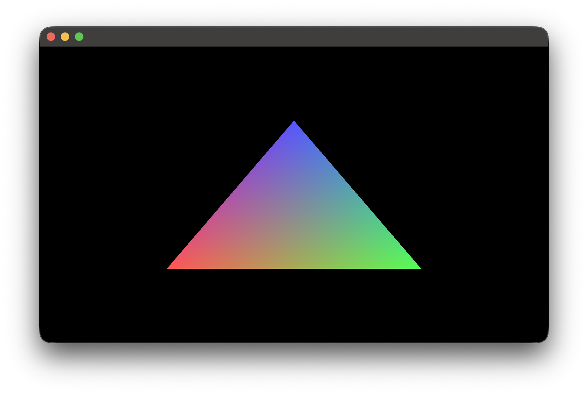

По итогу этого туториала вы сможете зарендерить цветной треугольник:


1. Следуя актуальному [README.md](README_ru.md) подключите зависимость Arc в ваш Kotlin проект.
2. Создайте файл, который будет содержать точку входа в ваше приложение. Например, создадим файл `main.kt`:
```kotlin
fun main() {
    // Наш код будет здесь
}
```
3. Так как Arc независим от реализации для начала нам нужно инициализировать базовые фабрики движка:
```kotlin
fun main() {
    // Инициализируем фабрики. Не стоит вдаваться в подробности
    // работы этого механизма - считайте это обычном "запускатором" внутренних механизмов
    ArcFactoryProvider.install()
    ArcFactoryProvider.bootstrap()
}
```
4. Теперь нам нужно инициализировать реализацию движка, в нашем случае OpenGL. Для этого мы вызываем метод `OpenGL.preload()`, который подготавливает все необходимые ресурсы для работы с OpenGL:
```kotlin
fun main() {
    ArcFactoryProvider.install()
    ArcFactoryProvider.bootstrap()

    // Предзагрузка OpenGL
    // Тоже своего рода механизм "запускатора", который подготавливает все необходимые ресурсы для работы с OpenGL
    // Важно: этот метод нужно вызвать до того, как вы начнете использовать OpenGL в вашем коде
    OpenGL.preload()
}
```
5. После этих шагов Arc готов к использованию. Теперь получим актуальную реализацию движка для текущего контекста:
```kotlin
fun main() {
    ArcFactoryProvider.install()
    ArcFactoryProvider.bootstrap()

    OpenGL.preload()

    // После инициализации OpenGL мы можем получить актуальную реализацию движка для текущего контекста с помощью
    // Application.find(). Этот метод возвращает объект Application, который является точкой входа в движок.
    val application = Application.find()
}
```

Вы ввели эти строчки кода, а окна не появилось? И программа сразу завершилась?
Тогда всё отлично - вы сделали всё правильно.
Arc не создаёт окно автоматически, так как это может быть не нужно в некоторых случаях.

6. Теперь давайте инициализируем базовые системы Arc - они создадут окно:
```kotlin
fun main() {
    ArcFactoryProvider.install()
    ArcFactoryProvider.bootstrap()

    OpenGL.preload()

    val application = Application.find()

    // Базовая инициализация движка. Она создаёт окно и запускает внутренние механизмы Arc.
    application.init()

    // Все строчки, что написаны выше - обычная подготовка, не стоит вдаваться в подробности работы этих механизмов.
    // Важно, что после вызова application.init() у нас появилось окно и мы можем использовать Arc.
}
```
Программа сразу завершилась?
Всё отлично - ведь программа буквально закончила своё выполнение - мы просто сказали сделать ей окно.
Она сделала окно и сразу завершила выполнение, так как мы не сказали ей что делать дальше.
Для этого существует цикл рендеринга, который мы рассмотрим в следующем шаге.
7. Бесконечный игровой цикл это фундаментальная механика любой игры:
```kotlin
fun main() {
    ArcFactoryProvider.install()
    ArcFactoryProvider.bootstrap()

    OpenGL.preload()

    val application = Application.find()

    application.init()

    // Бесконечный игровой цикл
    // Мы говорим программе работать до тех пор, пока окно не будет закрыто пользователем
    // Реализовать игровой цикл можно по-разному, но это самый простой способ, который подойдёт для большинства случаев.
    while (!application.window.shouldClose()) {

        // Здесь будет происходить рендеринг и обработка логики игры
    }
}
```
Теперь после запуска программы у вас должно появиться окно.
Если он "зависло" - это правильное поведение, так как программа пока что не обрабатывает события
взаимодействия с окном.
8. Сделаем одно простое действие, чтобы окно не "зависало":
```kotlin
fun main() {
    ArcFactoryProvider.install()
    ArcFactoryProvider.bootstrap()

    OpenGL.preload()

    val application = Application.find()

    application.init()

    while (!application.window.shouldClose()) {
        // Мы вызоваем функции beginFrame() и endFrame() у контекста для того, чтобы он обработал кадр игры
        // Это исправит проблему с зависшим окном - так как теперь игровые кадры действительно происходят.
        application.renderContext.beginFrame()

        // Наша будущая логика должна испольняться между началом и концом кадра.

        application.renderContext.endFrame()
    }
}
```
Отлично! Теперь у нас есть полноценное окно, которое отзывается на любые действия с ним.
Правда оно пустое, сейчас займёмся его заполнением.
9. Чтобы сказать, что рендерить мы должны передать некий массив данных на видеокарту:
```kotlin
fun main() {
    ArcFactoryProvider.install()
    ArcFactoryProvider.bootstrap()

    OpenGL.preload()

    val application = Application.find()

    application.init()

    while (!application.window.shouldClose()) {
        application.renderContext.beginFrame()

        // Наша будущая логика должна испольняться между началом и концом кадра.

        application.renderContext.endFrame()
    }
}

// Добавим новую функцию для создания такого "массива" - это называется вершинный буфер.
// Вершинный буфер как бы говорит видеокарте: "Поставь вот здесь вершину (точку), и задай ей вот такой цвет"
// Почему именно вершину? Всё просто - видеокарта рендерит треугольники. То есть мы должны указать три точки
// и она сама дорисуют всю остальную плоскость между ними.
private fun createBuffer(application: Application): VertexBuffer {
    // Для создания и настройки буфера вызовем функцию begin() у drawer в renderContext.
    val buffer: DrawBuffer = application.renderContext.drawer.begin(
        DrawerMode.TRIANGLES, // <- Выбираем, что мы будем рендерить треугольниками
        VertexFormat.builder() // А здесь задём информацию о том, что мы будем передавать о вершинах
            .add(VertexFormatElement.POSITION) // То есть каждая вершина будет иметь свою позицию
            .add(VertexFormatElement.COLOR) // И цвет
            .build()
    )

    // После того как мы настроили буфер мы можем добавить сами точки в него.
    // Используем соответствующую функцию addVertex и передаём в неё X Y Z координаты.

    // Как вы можете заметить указываются они не привычными пикселями.
    // В компьютерной графике плоскость окна приводится в диапазон от -1.0 до 1.0
    // То есть 0 - это всегда центр
    // -1.0 - это всегда крайний левый угол
    // 1.0 - это всегда крайний правый угол
    // Это делает графику адаптивной под любое разрешение по-умолчанию

    // И так по такому принципу мы указываем координаты у вершин
    // Первая:
    //   0f - по горизонтале в центре
    //   0.5f - по вертикале чуть выше центра
    //   Третья координата везде 0f так как Z отвечает за глубину, которая здесь не используется
    // И так с каждой вершиной, чтобы получить треугольник
    buffer.addVertex(0f, 0.5f, 0f).setColor(Color.BLUE)
    buffer.addVertex(-0.5f, -0.5f, 0f).setColor(Color.RED)
    buffer.addVertex(0.5f, -0.5f, 0f).setColor(Color.GREEN)

    // Как вы могли заметить у каждой вершины указан свой цвет.
    // По-умолчанию - видеокарта сделает плавный градиент между каждый вершиной.

    return buffer.build()
}
```
Теперь у нас есть функцию, которая создаёт вершинный буфер с треугольником. Но мы его пока что не используем.
Давайте разберемся как вывести это на экран.
10. Для того, чтобы вывести треугольник на экран нам нужно использовать шейдер. Шейдер - это программа, которая выполняется на видеокарте и отвечает за рендеринг графики.
```kotlin
fun main() {
    ArcFactoryProvider.install()
    ArcFactoryProvider.bootstrap()

    OpenGL.preload()

    val application = Application.find()

    application.init()

    while (!application.window.shouldClose()) {
        application.renderContext.beginFrame()

        // Наша будущая логика должна испольняться между началом и концом кадра.

        application.renderContext.endFrame()
    }
}

private fun createBuffer(application: Application): VertexBuffer {
    val buffer: DrawBuffer = application.renderContext.drawer.begin(
        DrawerMode.TRIANGLES,
        VertexFormat.builder()
            .add(VertexFormatElement.POSITION)
            .add(VertexFormatElement.COLOR)
            .build()
    )

    buffer.addVertex(0f, 0.5f, 0f).setColor(Color.BLUE)
    buffer.addVertex(-0.5f, -0.5f, 0f).setColor(Color.RED)
    buffer.addVertex(0.5f, -0.5f, 0f).setColor(Color.GREEN)

    return buffer.build()
}

// Определим отдельную функцию для создания шейдера:
private fun getShaderInstance(): ShaderInstance {

    // Выглядит страшно, но на самом деле это такой же обычный программный код,
    // но написанный на языке GLSL, который выполняется на видеокарте.
    // То есть тут мы буквально пишем программу для видеокарты, которая будет рендерить наш треугольник.
    // Шейдер обычно состоит из двух частей: вершинного шейдера и фрагментного шейдера.
    // Вершинный шейдер отвечает за обработку вершин, а фрагментный шейдер отвечает за обработку пикселей.
    // То есть вершинный определяет ГДЕ должна быть вершина на экране,
    // А фрагментный определяет КАКОЙ цвет должен быть у каждого пикселя, который находится внутри треугольника.

    // На данный момент можно не углубляться в детали работы шейдеров, так как это отдельная тема, которая требует отдельного изучения.
    // Просто воспользуйтесь этим кодом, чтобы получить рабочий шейдер для рендеринга треугольника.
    val vertexShader = """
        #version 410

        layout (location = 0) in vec3 Position;
        layout (location = 1) in vec4 Color;

        out vec4 vertexColor;

        void main()
        {
            gl_Position = vec4(Position, 1.0);

            vertexColor = Color;
        }
        """.trimIndent().asRuntimeAsset()

    val fragmentShader = """
        #version 410

        in vec4 vertexColor;
        out vec4 FragColor;

        void main()
        {
            FragColor = vertexColor;
        }
        """.trimIndent().asRuntimeAsset()

    return ShaderInstance.of(
        vertexShader,
        fragmentShader
    )
}
```
Теперь у нас есть программа для видеокарты и информацию о вершинах. Самое время воспользоваться этими частями и вывести итоговое изображение на экран.
11. Завершим наш игровой цикл, добавив в него рендеринг треугольника:
```kotlin
fun main() {
    ArcFactoryProvider.install()
    ArcFactoryProvider.bootstrap()

    OpenGL.preload()

    val application = Application.find()

    application.init()

    // Создаём объект ShaderInstance с помощью ранее написанной функции getShaderInstance()
    val shader: ShaderInstance = getShaderInstance()
    // Как и любую программу - шейдер так же требует компиляции перед использованием.
    // Для этого ОДИН раз вызываем метод compileShaders() у объекта ShaderInstance.
    shader.compileShaders()
    // После этого шейдер готов к использованию

    // Определим вершинный буфер с треугольником с помощью ранее написанной функции createBuffer()
    val buffer: VertexBuffer = createBuffer(application)

    while (!application.window.shouldClose()) {
        application.renderContext.beginFrame()

        // Для того, чтобы вывести треугольник на экран нам нужно "включить" шейдер.
        // Мы как бы говорим видеокарте: "Сейчас мы будем использовать этот шейдер для рендеринга"
        shader.bind()

        application.renderContext.drawer.draw(buffer) // <- Рисуем треугольник с помощью ранее созданного буфера

        shader.unbind() // <- После того как мы закончили использовать шейдер - его нужно "выключить"

        application.renderContext.endFrame()
    }
}

private fun createBuffer(application: Application): VertexBuffer {
    val buffer: DrawBuffer = application.renderContext.drawer.begin(
        DrawerMode.TRIANGLES,
        VertexFormat.builder()
            .add(VertexFormatElement.POSITION)
            .add(VertexFormatElement.COLOR)
            .build()
    )

    buffer.addVertex(0f, 0.5f, 0f).setColor(Color.BLUE)
    buffer.addVertex(-0.5f, -0.5f, 0f).setColor(Color.RED)
    buffer.addVertex(0.5f, -0.5f, 0f).setColor(Color.GREEN)

    return buffer.build()
}

private fun getShaderInstance(): ShaderInstance {
    val vertexShader = """
        #version 410

        layout (location = 0) in vec3 Position;
        layout (location = 1) in vec4 Color;

        out vec4 vertexColor;

        void main()
        {
            gl_Position = vec4(Position, 1.0);

            vertexColor = Color;
        }
        """.trimIndent().asRuntimeAsset()

    val fragmentShader = """
        #version 410

        in vec4 vertexColor;
        out vec4 FragColor;

        void main()
        {
            FragColor = vertexColor;
        }
        """.trimIndent().asRuntimeAsset()

    return ShaderInstance.of(
        vertexShader,
        fragmentShader
    )
}
```
Всё! На этом этапе мы завершили наш туториал. Если вы всё сделали правильно - у вас должно появиться окно с цветным треугольником как в начале.
Если цвета на треугольнике чуть-чуть отличаются - это нормально, так как видеокарты могут немного по-разному интерпретировать цвета
